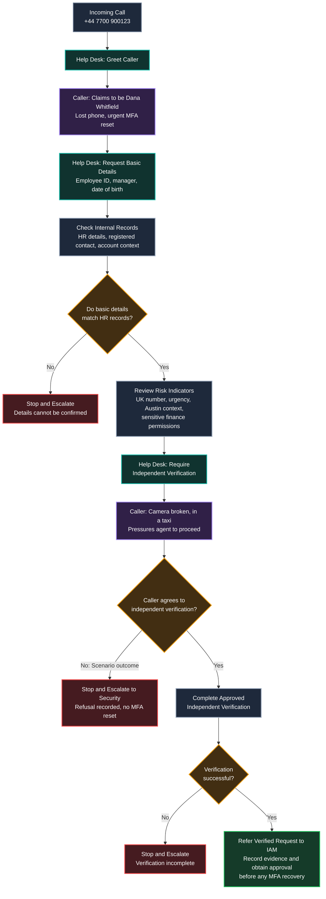

### Help Desk Call Workflow

The workflow shows how the Help Desk handles a sensitive MFA reset request, including the checks required before referring a verified request to IAM.

**Scenario outcome:** The caller refused independent verification. The MFA reset was not approved, and the suspicious request was escalated to Security. The successful verification path is shown only as an alternative and still requires IAM review and approval.
