## Help Desk Call Workflow

This workflow shows how the Help Desk should handle a sensitive MFA reset request before any recovery action is referred to IAM.

```mermaid
flowchart LR
    A["Incoming call<br/>+44 7700 900123"]
    B["Help Desk greeting"]
    C["Caller requests MFA reset<br/>Claims to be Dana Whitfield,<br/>VP of Finance"]
    D["Collect basic details<br/>Employee ID<br/>Manager name<br/>Date of birth"]
    E["Check internal records<br/>HR contact number<br/>Recent sign in context<br/>Account sensitivity"]
    F{"Do basic details match<br/>HR records?"}

    G["Stop and escalate<br/>Details cannot be confirmed<br/>No MFA reset"]
    H["Red flags noted<br/>UK number differs from HR record<br/>Urgency and authority pressure<br/>Travel story conflicts with Austin context<br/>Sensitive finance account"]
    I["Require independent verification<br/>Use a trusted company method<br/>Callback or another approved method"]
    J{"Does the caller agree<br/>to independent verification?"}

    K["Stop and escalate<br/>Independent check refused<br/>No MFA reset<br/>Escalate to IAM or Security"]
    L["Complete independent verification<br/>Callback to number on file<br/>or another approved method"]
    M{"Was independent verification<br/>successful?"}

    N["Stop and escalate<br/>Verification failed or incomplete<br/>No MFA reset"]
    O["Verified request<br/>Refer to IAM for recovery review<br/>and approved MFA reset process"]

    A --> B --> C --> D --> E --> F
    F -- No --> G
    F -- Yes --> H --> I --> J
    J -- "No, actual case" --> K
    J -- Yes --> L --> M
    M -- No --> N
    M -- Yes --> O

    classDef start fill:#1f2937,stroke:#94a3b8,color:#ffffff,stroke-width:2px
    classDef process fill:#0f766e,stroke:#2dd4bf,color:#ffffff,stroke-width:2px
    classDef caller fill:#4c1d95,stroke:#c4b5fd,color:#ffffff,stroke-width:2px
    classDef review fill:#1e3a5f,stroke:#93c5fd,color:#ffffff,stroke-width:2px
    classDef decision fill:#5b3a0a,stroke:#f59e0b,color:#ffffff,stroke-width:2px
    classDef stop fill:#7f1d1d,stroke:#f87171,color:#ffffff,stroke-width:2px
    classDef success fill:#14532d,stroke:#4ade80,color:#ffffff,stroke-width:2px

    class A start
    class B,D,I,L process
    class C caller
    class E,H review
    class F,J,M decision
    class G,K,N stop
    class O success
```

**Scenario outcome:** In Dana's case, the caller refused independent verification. The MFA reset was not approved, and the suspicious request was escalated to IAM or Security. The successful path is shown only as the approved alternative.
